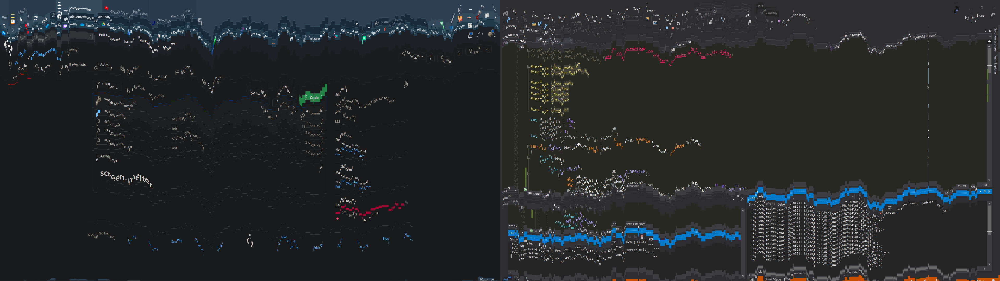

# screen-melter

The project is based on [Napalm's code](http://www.rohitab.com/discuss/topic/23191-screen-melter/?p=190669).
It also implements **multi-monitor support** and **DPI awareness**.



### Args:

| Arg                        | Type     | Description                                                                                   |
| -------------------------- | -------- | --------------------------------------------------------------------------------------------- |
| `-t`, `--time`             | `number` | Delay before visual effect starts (**ms**)                                                    |
| `-e`, `--exit_time`        | `number` | The program will automatically exit after this amount of time (**ms**)                        |
| `-I`, `--disable_input`    | `flag`   | Disables keyboard and mouse input, `ctrl+alt+del` still works                                 |
| `-K`, `--disable_keyboard` | `flag`   | Disables keyboard input, `ctrl+alt+del` still works                                           |
| `-M`, `--disable_mouse`    | `flag`   | Disables mouse input                                                                          |
| `-k`, `--kill_explorer`    | `flag`   | Kills all explorer.exe processes and restarts the root (desktop) process on application exit  |
| `-T`, `--topmost`          | `flag`   | Runs window always on top                                                                     |
| `-B`, `--start_on_boot`    | `string` | The program will launch with provided args on next boot                                       |
| `--enable_network`         | `flag`   | Enables the TCP listener and waits for an authenticated activation request (default: disabled) |
| `--network_key`            | `string` | No default; required and non-empty when network mode is enabled                                |
| `--port`                   | `integer`| TCP listening port; default `47621`, valid range `1`–`65535`                                  |
| `--network_timeout`        | `integer`| Maximum time to receive a complete request from a connected client, in milliseconds; default `5000`, valid range `1`–`60000` |

### Usage

- `screen-melter.exe -M --disable_keyboard -t 20 --exit_time=10000`
- `screen-melter.exe -B "-t 2000 --exit_time=10000"`
- `screen-melter.exe --enable_network --network_key "replace-with-a-long-random-secret" --port 47621 --network_timeout 5000`

### Network trigger protocol

Network mode is opt-in. When enabled, the application listens on all IPv4 network interfaces (`0.0.0.0`) on the selected TCP port (default `47621`).
This can expose the listener to other devices on those networks. The application does not change Windows Firewall rules.
A port conflict or other Winsock startup/bind/listen failure is reported before the effect starts.

Send one UTF-8/ASCII request in this exact format, with the configured key substituted for `<key>` and an LF newline byte (`0x0A`) at the end:

```text
SM1:<key><LF>
```

For a key `example-secret`, a client can send the following from Python:

```python
import socket

with socket.create_connection(("127.0.0.1", 47621)) as connection:
    connection.sendall(b"SM1:example-secret\n")
```

The server reads the byte stream until the newline, checks the exact `SM1:` prefix and exact key, and closes the connection. Requests are **limited to 512 bytes**.
Incomplete, malformed, oversized, and incorrect requests are ignored, the listener continues accepting new connections.
Only the first valid request triggers the effect, after which the listener stops. `--network_timeout` is a total deadline, in milliseconds, for receiving a complete request after a client connects.
It does not stop the listener when no clients connect. Client connections are handled one at a time, with a bounded listen backlog.

### Requirements

[Microsoft Visual C++ Redistributable](https://learn.microsoft.com/en-us/cpp/windows/latest-supported-vc-redist?view=msvc-170#visual-studio-2015-2017-2019-and-2022)

### License

This project is licensed under the MIT License - see the [MIT License](LICENSE) file for details.
